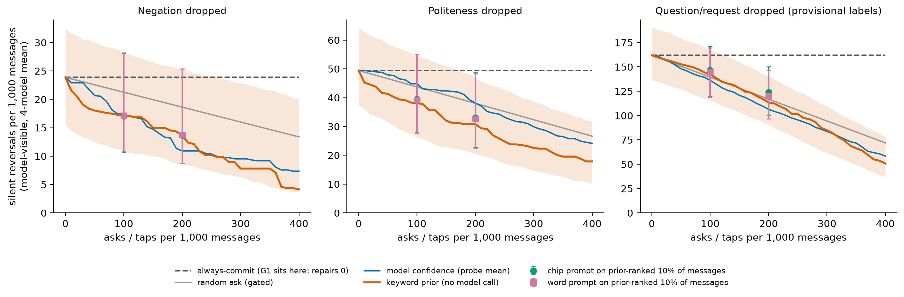

# default_profiles, round 2 (post-pilot amendments): results

Date 2026-11-02. Plan and rules: `PLAN.md` section 9 (written before any number below was computed; every change is POST-PILOT). Machine-only evidence: stored outputs, a local logprob probe, no human labels, no generation, no J1 fallback. **Speech-act and politeness numbers remain provisional** (detector-proxy source labels; `ANNOTATION_REQUEST.md` written, not sent). This file is generated by `src/frontier_default_profiles_report.py` from the CSVs and checked by `src/frontier_default_profiles_check.py`. All CIs are 95% message-cluster percentile bootstraps (B = 1000, strata random/enriched, seed 20261101) unless stated.

## Headline (what is and is not defensible)

1. **The framework result stands; the 'proposed prior' result does not.** With the CV prior refit inside every bootstrap replicate (lambda tuned inside folds) and the primary random baseline gated like the other policies, **0 of 4 pre-named primary contrasts are significant after Holm** (table in section 3). On polarity the prior leaves 17.1 [10.7, 28.2] model-visible silent reversals per 1,000 messages at 100 asks per 1,000, versus 21.3 [13.8, 29.0] for gated-random and 17.4 [11.2, 23.5] for probe-mean confidence; always-commit is 23.9. Round 1's 'prior beats random' used an ungated random baseline and a prior scored once outside the bootstrap; neither survives.
2. **A model's own forced-choice confidence is a suggestive, modest signal on polarity**: probe-mean confidence vs gated-random at 10% is -3.8 [-7.6, -0.9] per 1,000 (BH q = 0.059, exploratory, so not significant at .05); the single model qwen2.5-7b gives -7.0 [-12.3, -2.4] (q = 0.018). It carries little exposure signal where its AUROC is near 0.5 (section 1).
3. **G1 is not inert on bare keywords, it is harmful for politeness (measured).** Running the real `interventions.check` on all 7,200 stored P0 outputs: it flags 176.8 per 1,000 outputs (HT-weighted), every flag is `politeness:added`, it flagged 100.6 per 1,000 correct polite outputs (100% of them) and repaired 0 dropped negations or questions (its feedback only ever names politeness). Worst case, if regeneration stripped every flagged correct polite output: +100.6 silent politeness reversals per 1,000 (not generated; upper bound).
4. **Contribution as a measurement framework**: exposure vs model-visible reversals, SLP-weighted, with ask budgets and tap counts, applied to the study's interventions on the same units, plus honest nulls for H2, H3 (polarity/politeness untestable by design, speech act placebo fails) and H4.

## Corrections and retractions (R2-1, R2-2)

- **Retracted:** round-1 'polarity +2.5 pp overconfidence, I^2 = 0'. It compared a greedy argmax output rate with a 2.7% posterior; a calibrated model decoded greedily outputs the majority reading nearly always, so the gap was a base-rate artefact. Not repeated anywhere. The greedy rate is still tabulated in `h1_belief_scale.csv` labelled 'NOT calibration'.
- **Misreport corrected:** round1.md said politeness prior vs confidence was 'not significant'. Its own CSV (`policy_paired_contrasts.csv`, exposure event, 3-model mean) shows -9.8 [-19.6, -2.0] per 1,000 with CI excluding 0. Under the round-2 design (refit prior, model-visible event) the same contrast is -6.7 [-17.3, 4.0], CI includes 0, adjusted p = 1.00. The round-1 claim of a politeness prior advantage over confidence therefore does not survive the stricter bootstrap either. round1.md is left unedited as the archival record.
- Round-1 sign convention is replaced by MODEL MINUS EMPIRICAL (PLAN R2-1). DerSimonian-Laird random effects and I^2 are dropped (shared items). Round-1 gap/I^2 numbers should not be cited.

## What was and was not run

Run: H1 on the belief scale for 3 of 5 local probe models (gemma3-4b, llama3.1-8b, qwen2.5-7b); policy curves with the prior refit in each of 1000 bootstrap replicates; same-items interventions comparison; G1 inertness measured on stored outputs; SLP acceptability (stored); figure; annotation request. **Not run:** qwen2.5-14b and mistral-nemo-12b probes (the queued probe job was SIGSTOPped by the owner's GPU pause for a Unity render, `GPU-PAUSE-NOTE.md`; I did not start new `/tmp/aacv_gpu.lock` jobs; re-run `src/frontier_default_profiles_r2.py` after it resumes and every table refreshes with 5 models); the verbalized-confidence arm (the shared codex-lb endpoint timed out repeatedly: 38 of about 1,700 unique keyword strings completed in ~40 minutes, below the declared 300-string floor, so it is excluded and **not reported**); sampled-rate calibration for local models (GPU); a CLAM-style few-shot ambiguity classifier (documented in PLAN R2-3; the entropy policy is only a stand-in and is not called CLAM); S3 RG/PPI and S4 DIF (out of scope by declaration R2-8).

## 1. H1 on the belief scale (human keywords; model minus empirical)

Among units whose keywords lack the lexical cue: empirical rate = HT-weighted share whose source has the cue; q = forced-choice probability of the cue-bearing reading (mean of two framings). Gap in percentage points, ECE in pp, BSS = Brier skill vs predicting the constant empirical rate (negative = worse than constant), AUROC = q for predicting exposure among gate-eligible units. A probe is a **valid comparator** here only if the AUROC CI lower bound > 0.5 (PLAN R2-3, replaces the round-1 Spearman stop rule).

| dimension | model | empirical rate % | mean q % | gap pp | ECE pp | BSS | AUROC exposure | valid comparator |
|---|---|---|---|---|---|---|---|---|
| negation | gemma3-4b | 2.7 [1.8, 3.7] | 49.0 [46.9, 50.9] | 46.4 [44.0, 48.5] | 46.4 [44.0, 48.5] | -10.24 [-16.03, -7.12] | 0.57 [0.47, 0.67] | NO |
| negation | llama3.1-8b | 2.7 [1.8, 3.7] | 37.3 [36.3, 38.2] | 34.6 [33.3, 35.8] | 34.6 [33.3, 35.8] | -4.88 [-7.70, -3.32] | 0.69 [0.60, 0.77] | yes |
| negation | qwen2.5-7b | 2.7 [1.8, 3.7] | 39.4 [37.3, 41.5] | 36.8 [34.6, 39.0] | 37.0 [34.8, 39.1] | -7.45 [-11.81, -5.08] | 0.67 [0.56, 0.77] | yes |
| politeness | gemma3-4b | 6.5 [5.0, 8.4] | 51.0 [50.2, 51.8] | 44.5 [42.3, 46.3] | 44.5 [42.3, 46.3] | -3.43 [-4.72, -2.47] | 0.55 [0.49, 0.61] | NO |
| politeness | llama3.1-8b | 6.5 [5.0, 8.4] | 22.0 [21.4, 22.6] | 15.5 [13.4, 17.2] | 15.5 [13.5, 17.2] | -0.46 [-0.73, -0.28] | 0.54 [0.47, 0.61] | NO |
| politeness | qwen2.5-7b | 6.5 [5.0, 8.4] | 7.8 [6.9, 8.8] | 1.3 [-0.9, 3.2] | 6.9 [5.2, 8.8] | -0.20 [-0.32, -0.11] | 0.53 [0.44, 0.61] | NO |
| question/request | gemma3-4b | 47.7 [42.5, 53.0] | 79.7 [77.4, 82.1] | 32.0 [26.3, 37.5] | 32.0 [27.4, 37.5] | -0.51 [-0.69, -0.34] | 0.56 [0.51, 0.62] | yes |
| question/request | llama3.1-8b | 47.9 [42.8, 53.2] | 62.3 [61.5, 63.1] | 14.4 [9.0, 19.4] | 14.7 [10.6, 19.9] | -0.02 [-0.10, 0.04] | 0.60 [0.55, 0.66] | yes |
| question/request | qwen2.5-7b | 47.9 [42.8, 53.2] | 51.1 [47.5, 54.3] | 3.2 [-1.8, 8.0] | 12.5 [9.9, 17.2] | 0.17 [0.05, 0.27] | 0.69 [0.64, 0.74] | yes |

- negation: gaps 46.4, 34.6, 36.8 pp; range 11.8 [10.1, 13.3] pp; same sign with every CI excluding 0: **yes** -> 'profile gap present' by the R2-1 rule.
- politeness: gaps 44.5, 15.5, 1.3 pp; range 43.2 [42.3, 44.0] pp; same sign with every CI excluding 0: **no** -> 'model-dependent' by the R2-1 rule.
- question/request: gaps 32.0, 14.4, 3.2 pp; range 28.7 [25.5, 32.0] pp; same sign with every CI excluding 0: **no** -> 'model-dependent' by the R2-1 rule.

**Reading.** On polarity every probe model puts far more weight on 'negated' (49%, 37%, 39%) than the human base rate (2.7%) and is worse than a constant predictor (BSS < 0): the belief-scale finding is the OPPOSITE of the retracted 'overconfident default', but a yes/no forced-choice probe has acquiescence bias, so I do **not** claim under- or over-confidence; I report the measured discrepancy and that q still carries some exposure signal only for models marked valid. Greedy generation commits to the default regardless of q, which is the profile the AAC user meets.

## 2. Ask policies, same 1,800 units (10% ask budget = 100 asks per 1,000 messages)

Primary event = **model-visible silent reversals per 1,000 messages** (exposure units x mean miss rate of the four stored models). The model-independent exposure event (upper bound) is in the second table. Gated random is the primary random baseline. Prior is refit inside each replicate.

**model-visible**

| policy | negation | politeness | question/request |
|---|---|---|---|
| always-commit | 23.9 [15.5, 32.5] | 49.4 [37.3, 64.3] | 161.9 [136.1, 190.6] |
| random ask, ungated (secondary) | 21.5 [13.9, 29.3] | 44.5 [33.6, 57.9] | 145.7 [122.5, 171.5] |
| random ask, gated (PRIMARY baseline) | 21.3 [13.8, 29.0] | 43.7 [33.0, 56.8] | 139.4 [117.2, 164.8] |
| shortest-keywords-first, gated | 23.0 [14.9, 31.8] | 40.6 [30.2, 54.1] | 131.4 [108.9, 156.8] |
| entropy / most-uncertain-first (not CLAM) | 19.3 [12.3, 26.8] | 44.6 [32.4, 58.0] | 146.7 [123.7, 174.0] |
| confidence, probe mean | 17.4 [11.2, 23.5] | 44.8 [32.4, 58.2] | 136.0 [111.4, 162.7] |
| confidence, gemma3-4b | 21.0 [13.1, 28.7] | 43.9 [32.4, 59.7] | 138.6 [114.9, 166.0] |
| confidence, llama3.1-8b | 17.4 [11.0, 23.8] | 44.3 [32.4, 58.3] | 145.4 [121.0, 171.9] |
| confidence, qwen2.5-7b | 14.3 [9.1, 20.1] | 45.4 [33.4, 59.3] | 137.6 [114.4, 163.5] |
| keyword prior (no model call), refit | 17.1 [10.7, 28.2] | 38.1 [26.2, 54.2] | 142.3 [115.8, 166.9] |

**exposure (upper bound)**

| policy | negation | politeness | question/request |
|---|---|---|---|
| always-commit | 24.4 [16.1, 33.1] | 56.4 [43.0, 72.6] | 277.5 [240.4, 314.4] |
| random ask, ungated (secondary) | 21.9 [14.5, 29.8] | 50.7 [38.7, 65.3] | 249.7 [216.4, 282.9] |
| random ask, gated (PRIMARY baseline) | 21.7 [14.3, 29.5] | 49.9 [38.1, 64.3] | 240.7 [207.7, 273.4] |
| shortest-keywords-first, gated | 23.5 [15.4, 32.3] | 46.7 [35.4, 61.2] | 230.9 [197.6, 265.6] |
| entropy / most-uncertain-first (not CLAM) | 19.7 [12.7, 27.4] | 49.7 [36.7, 64.7] | 259.8 [226.0, 294.5] |
| confidence, probe mean | 17.5 [11.2, 23.5] | 50.0 [36.9, 64.7] | 224.1 [190.7, 257.5] |
| confidence, gemma3-4b | 21.1 [13.3, 28.8] | 50.7 [38.1, 67.2] | 235.7 [201.7, 271.9] |
| confidence, llama3.1-8b | 17.5 [11.1, 23.9] | 49.3 [36.8, 64.0] | 227.8 [193.9, 261.5] |
| confidence, qwen2.5-7b | 14.3 [9.2, 20.1] | 50.5 [37.8, 65.9] | 230.8 [198.4, 265.4] |
| keyword prior (no model call), refit | 17.4 [11.0, 28.7] | 42.1 [30.3, 60.5] | 233.5 [193.6, 266.4] |

Speech-act exposure units unreachable by any gated policy (cue present in source, lexical gate cue present in the keywords): **52 of 417**; polarity 0 of 76, politeness 0 of 136.

## 3. Contrasts (10% budget; model-visible; difference = A minus B in reversals per 1,000, negative favours A)

Primary family (Holm over 4; bootstrap two-sided p; TOST margins 5 / 10 / 25 per 1,000 for polarity / politeness / speech act, fixed in PLAN):

| contrast | A | B | diff [95% CI] | relative reduction vs B | p | Holm p | equivalent by TOST? |
|---|---|---|---|---|---|---|---|
| negation: prior vs gated random | 17.1 | 21.3 | -4.2 [-9.0, 2.2] | 20% [-11, 42] | 0.642 | 1.000 | no (not distinguishable, not equivalent) |
| negation: prior vs confidence (mean) | 17.1 | 17.4 | -0.4 [-4.4, 7.7] | 2% [-47, 25] | 0.475 | 1.000 | no (not distinguishable, not equivalent) |
| politeness: prior vs gated random | 38.1 | 43.7 | -5.6 [-15.7, 3.1] | 13% [-7, 32] | 0.425 | 1.000 | no (not distinguishable, not equivalent) |
| politeness: prior vs confidence (mean) | 38.1 | 44.8 | -6.7 [-17.3, 4.0] | 15% [-10, 35] | 0.393 | 1.000 | no (not distinguishable, not equivalent) |

**H4 verdict: NOT MET.** Prior vs confidence on polarity: 2% fewer reversals [-47, 25]; the criterion was >= 25% with CI excluding 0. Equivalence is also not shown (90% CI [-3.6, 6.8] vs margin +-5): with 76 polarity exposure units the policies are **not distinguishable**, nothing more.

Exploratory contrasts: 212 (prior vs each baseline, each confidence vs gated random, 5/10/20% budgets, both events); **15 have BH q < .05**, listed in `contrasts_r2.csv`. On the primary model-visible event: negation conf_gated_qwen2.5-7b vs random_gated at 10%: -7.0 [-12.3, -2.4] (q = 0.018); negation conf_gated_mean vs random_gated at 20%: -7.7 [-12.9, -2.3] (q = 0.018); negation conf_gated_qwen2.5-7b vs random_gated at 20%: -6.4 [-11.3, -2.3] (q = 0.018). All other BH-significant rows are on the exposure (upper-bound) event.

## 4. Same-items comparison of the study's interventions (R2-4)

Per 1,000 messages, model-visible. Ask rows assume the user then supplies the cue; chip / plain-word rows apply the measured cue-honouring rate rho (chip1 / natural-language cue, pooled four models, hw1 pairs: transported, not measured on these units). Taps: 1 per prompt shown (sensitivity 2 taps = double the taps column). SLP-weighted = weight x reversals (negation 1.0, question/request 0.8, politeness 0.5; two raters, descriptive).

| dimension | strategy | taps / 1,000 | reversals / 1,000 [CI] | SLP-weighted | avoided vs commit |
|---|---|---|---|---|---|
| negation | always-commit | 0 | 23.9 [15.5, 32.5] | 23.9 | 0.0 |
| negation | G1 guard: reversals repaired = 0 (measured) | 0 | 23.9 [15.5, 32.5] | 23.9 | 0.0 |
| negation | chip on 10% prior-ranked | 100 | 17.1 [10.7, 28.2] | 17.1 | 6.8 |
| negation | plain word on 10% prior-ranked | 100 | 17.1 [10.8, 28.2] | 17.1 | 6.7 |
| negation | chip on 10% random (gated) | 100 | 21.3 [13.8, 29.0] | 21.3 | 2.6 |
| negation | chip on 10% confidence-ranked | 100 | 17.5 [11.2, 23.5] | 17.5 | 6.4 |
| negation | chip on 20% prior-ranked | 200 | 13.7 [8.7, 25.4] | 13.7 | 10.2 |
| negation | chip on every message | 1000 | 0.1 [0.1, 0.2] | 0.1 | 23.8 |
| politeness | always-commit | 0 | 49.4 [37.3, 64.3] | 24.7 | 0.0 |
| politeness | G1 guard: reversals repaired = 0 (measured) | 0 | 49.4 [37.3, 64.3] | 24.7 | 0.0 |
| politeness | G1 guard, WORST CASE (every flagged correct polite output stripped) | 0 | 150.1 [137.9, 164.9] | 75.0 | -100.6 |
| politeness | chip on 10% prior-ranked | 100 | 39.5 [27.8, 55.1] | 19.7 | 10.0 |
| politeness | plain word on 10% prior-ranked | 100 | 39.2 [27.6, 54.9] | 19.6 | 10.2 |
| politeness | chip on 10% random (gated) | 100 | 44.4 [33.5, 57.7] | 22.2 | 5.0 |
| politeness | chip on 10% confidence-ranked | 100 | 45.4 [33.0, 58.8] | 22.7 | 4.1 |
| politeness | chip on 20% prior-ranked | 200 | 33.0 [22.9, 48.6] | 16.5 | 16.4 |
| politeness | chip on every message | 1000 | 5.8 [4.4, 7.6] | 2.9 | 43.6 |
| question/request | always-commit | 0 | 161.9 [136.1, 190.6] | 129.5 | 0.0 |
| question/request | G1 guard: reversals repaired = 0 (measured) | 0 | 161.9 [136.1, 190.6] | 129.5 | 0.0 |
| question/request | chip on 10% prior-ranked | 100 | 146.5 [120.2, 171.4] | 117.2 | 15.4 |
| question/request | plain word on 10% prior-ranked | 100 | 144.9 [118.4, 169.7] | 115.9 | 17.0 |
| question/request | chip on 10% random (gated) | 100 | 144.2 [121.3, 170.3] | 115.3 | 17.7 |
| question/request | chip on 10% confidence-ranked | 100 | 141.5 [116.8, 168.0] | 113.2 | 20.4 |
| question/request | chip on 20% prior-ranked | 200 | 123.8 [100.5, 150.0] | 99.1 | 38.1 |
| question/request | chip on every message | 1000 | 34.4 [29.0, 40.5] | 27.5 | 127.4 |

The chip on every message removes nearly all polarity reversals (0.1 left) but costs 1,000 taps per 1,000 messages; the cheap point is the ranking, and ranking by the prior is not distinguishable from random or confidence (section 3). The chip and plain word are interchangeable in reversal terms (rho 0.995 vs 0.987). For question/request rho is only ~0.8-0.9, so prompting cannot fully repair that dimension.

**Acceptability (stored SLP panel, task 2, 'acceptable = yes'; different items from the exposure units, W-C pairs; 2 raters; descriptive):**

| arm | rater-items | acceptable yes | share [Wilson 95%] | edit | no |
|---|---|---|---|---|---|
| chip | 20 | 13 | 65 [43, 82]% | 5 | 2 |
| guard_original | 20 | 0 | 0 [0, 16]% | 10 | 10 |
| guard_repair | 40 | 13 | 32 [20, 48]% | 11 | 16 |
| word | 20 | 10 | 50 [30, 70]% | 8 | 2 |

Chip and plain-word outputs are rated acceptable more often than guard repairs, but the guard rows are on judge-failed originals and the item sets differ, so no contrast is tested.

## 5. Estimands, H2, H3

- H3 for polarity and politeness is **not testable by design**: the A/B pair design makes bare critical-match exactly 0.5 whenever a model always commits to one reading, so the placebo difference is 0 by construction (round 1 reported it as CI [0,0]). Informative dimensions only: the speech-act placebo fails (irrelevant chip shifts output +4.8 pp, round-1 stored estimate, `placebo_h3.csv`, not re-estimated), so the speech-act assumption/violation split is not reported as causal.
- H2 (carried from round 1, stored CSV): weighted points per 1,000 = question/request 129.5, politeness 24.7, negation 23.9; weighting does not change the ranking (not met).

## 6. Where the methods do NOT help

- negation at 10% asks: prior removes 6.8 [0.3, 11.9] per 1,000 (29%), confidence 6.5, gated random 2.6; asks per reversal avoided: prior 14.7, random 38.1.
- politeness at 10% asks: prior removes 11.3 [2.5, 22.3] per 1,000 (23%), confidence 4.6, gated random 5.7; asks per reversal avoided: prior 8.9, random 17.5.
- question/request at 10% asks: prior removes 19.5 [11.7, 32.8] per 1,000 (12%), confidence 25.9, gated random 22.5; asks per reversal avoided: prior 5.1, random 4.4.
- Question/request: no ranking beats gated random on the model-visible event; 52 of 417 exposed units are unreachable; the human-keyword break-even is near 1:1 so asking is near-uninformative; chip rho is below 0.9.
- G1: repairs nothing on bare keyword input and strips correct politeness (section 'Headline' 3). The chip/plain word help only where they are shown, i.e. they cost a tap on every prompted message.

## 7. Limits and problems (honest)

- 3 of 5 probe models; sampled-rate and verbalized calibration not run; CLAM-style classifier not implemented; 76 polarity exposure units give wide CIs (prior CI width about 17 per 1,000).
- Speech-act and politeness exposure depend on detector-proxy source labels; the model-visible event is the lead number and the exposure event is an upper bound. rho for chip/word is transported from hw1 pairs. Acceptability is on different items. G1 harm is an upper bound (no regeneration run). Units are classmate keyword sets (about 20 adults), not AAC users: no user-benefit claim.
- The bootstrap p-values are percentile-bootstrap, not null-distribution tests; Holm covers only the 4 named contrasts.
- Probe `q` is the mean of two framings (declared in round 1); the q0 variant is exploratory and not used.

## Artifacts

`h1_belief_scale.csv`, `h1_reliability_bins.csv`, `policy_curves_r2.csv`, `policy_budgets_r2.csv`, `contrasts_r2.csv`, `intervention_same_items.csv`, `acceptability_slp.csv`, `g1_inertness.json`, `g1_inertness_rows.csv`, `summary_r2.json`, `summary.json`, `claims.json`, `fig_reversals_vs_asks.png/.pdf`, `ANNOTATION_REQUEST.md` (+ `annotation/frontier_default_profiles_items.json`, `annotation/frontier_default_profiles_key.csv`). Scripts: `src/frontier_default_profiles_{r2,g1check,verbal,report,check,fig,annot}.py`. Raw probe outputs: `runs/frontier_default_profiles_probe/`.

Figure: model-visible silent reversals per 1,000 messages vs asks (taps) per 1,000, 4-model mean; prior band = 95% bootstrap CI with the prior refit; chip and plain-word points (prior-ranked 10% and 20%) overlap because rho is near 1 for negation. G1 sits on the always-commit line (repairs 0).
