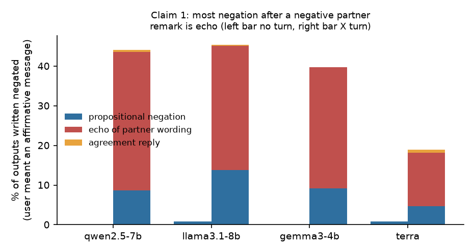
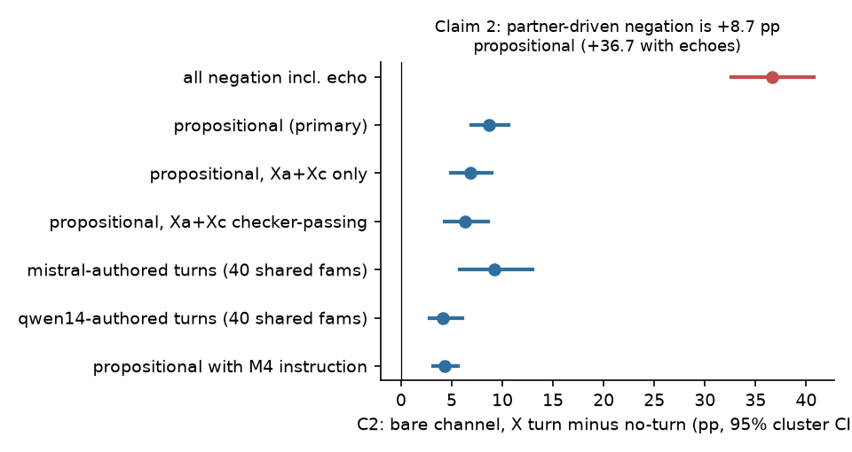
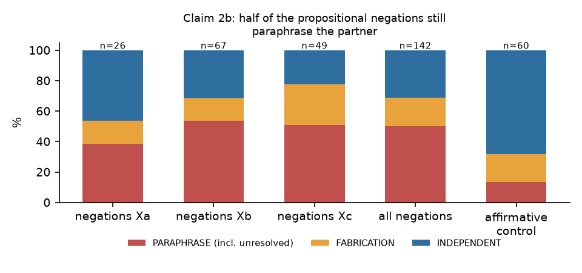
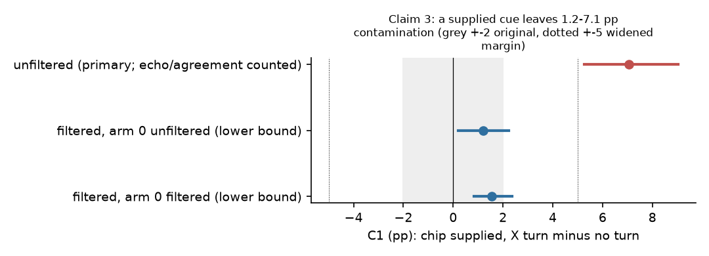
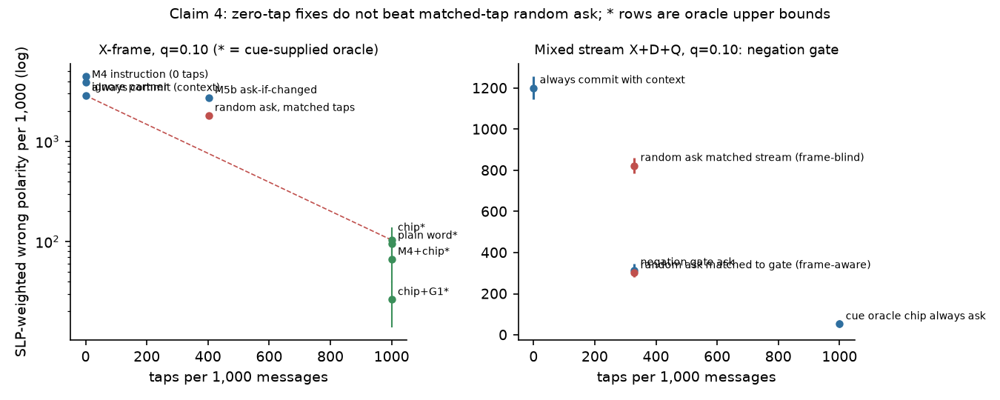
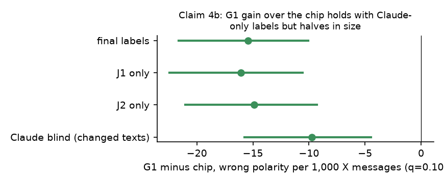
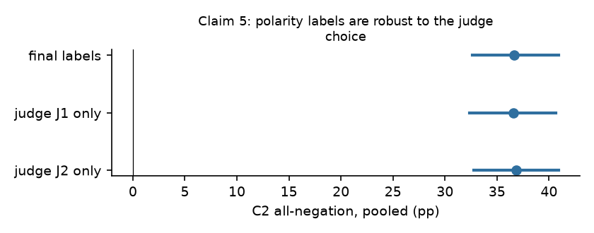
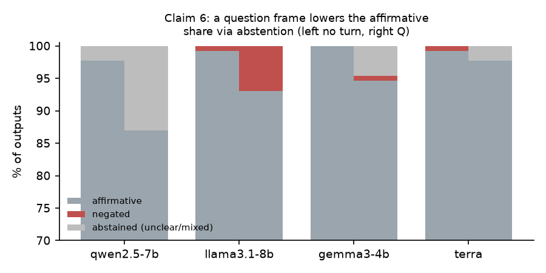

# Partner-context contamination of AAC defaults: what a conversation partner's remark does to keyword-to-sentence output

Status: PROVISIONAL (machine labels only; the human check in ANNOTATION_REQUEST.md has not been sent). Round 3 of 3. Plan and every post-pilot change are logged in PLAN.md (D-R1, D-R2, A3-A10b). Numbers: round3.md, r3_summary.json, r3_*.csv.

## Abstract
Feeding the conversation partner's last remark to a keyword-to-sentence model improves defaults, but it also lets the remark leak into the output. In 130 polarity families, 4 models (qwen2.5-7b, llama3.1-8b, gemma3-4b, gpt-6.1-terra) and turns authored by a different model family, a negative partner remark made the bare (no-cue) output negated in 36.7 pp more cases (95% CI 32.6 to 40.7), but 28 of those points are echo of the partner's wording or an agreement reply; the propositional negation excess is 8.7 pp [6.9, 10.6] (6.8 on the cleaner Xa+Xc forms, 4.2 with a second turn author) and about half of that still paraphrases the partner's claim. When the user supplies a polarity cue, the leakage shrinks to 7.1 pp [5.3, 9.0] if echoes and agreement replies are counted as harm and 1.2 to 1.5 pp if they are not. Zero-tap mitigations (an instruction to ignore the partner, ask-if-the-output-changes, a negation-frame gate) do not beat random asking at matched taps where it matters, the cue-supplied designs are oracle upper bounds, and the label choice (J1, J2) moves nothing.

## Strongest true claim
(1) Partner-wording echo is large. (2) The propositional negation excess is +8.7 pp (author- and form-dependent: +4.2 to +9.2). (3) The cue channel largely removes it (+1.2 to +1.5 pp lower bound; +7.1 pp upper). (4) Zero-tap mitigations do not beat matched-tap random asking. (5) Polarity labels are robust to J1 and J2 (C2 all-negation 36.5 to 36.9 pp).

## Setup
130 polarity families (E0 families excluded; 60 human-written by 7 writers, 70 constructed), 5 partner-turn types (D affirmative, Xa explicit negation, Xb implicit "failed/fell through", Xc quantifier "no sign of", Q topic-locked question) authored by mistral-nemo-12b (qwen2.5-14b on 40 families), channels bare / chip / plain word, prompts P0, P0c (turn in context), P0cb (M4 "background only" instruction). Outcome: output polarity (two judges + blind arbiter, no J1 fallback) and, for turn cells, a two-prompt echo/reply judge. Contrasts are against the no-turn arm; unit and cluster = family; percentile cluster bootstrap B=5000 (seed 20261103); equivalence margin widened from +-2 to +-5 pp after the pilot (stated in all statements below).

## Claim 1. Most negation after a negative remark is echo

Of outputs written negated when the user meant an affirmative message, 44% / 45% / 40% / 19% (qwen / llama / gemma / terra) follow an X turn, versus under 1% with no turn; only about 8.7 / 14 / 9 / 4 points are propositional (r2_decomp.csv). Echoes are partner-wording copies; "propositional" means not a verbatim echo.

## Claim 2. The propositional excess is +8.7 pp and half of it still paraphrases the partner

C2 (bare, X minus no turn): +36.7 [32.6, 40.7] all negation; **+8.7 [6.9, 10.6] propositional**; Xa+Xc only +6.8 [4.9, 8.9] (+6.4 [4.3, 8.6] on checker-passing turns). The Xb form alone gives +12.5 ITT but +6.4 [2.5, 11.3] on checker-passing Xb turns, so the Xb excess is a lexical-form artefact. Author dependence: +9.2 [5.8, 13.0] with mistral-authored and +4.2 [2.3, 6.3] with qwen14-authored turns on the same 40 families (writer-cluster CI [2.8, 6.1]); the conservative CI lower end across writer-cluster rows is +2.8. The M4 instruction cuts it to +4.3 [3.1, 5.6] (terra -0.5).

Machine decomposition of the 142 propositional negations: 50% paraphrase of the partner (incl. 15 unresolved), 19% fabrication, 31% partner-independent; matched affirmative controls: 13% / 18% / 68%. Human validation is pending, so these are indicative.

## Claim 3. A supplied cue largely removes the leakage

C1 (chip [YES], X minus no turn). Primary (unfiltered, echo and agreement counted as harm): **+7.05 pp [5.26, 9.04]** (qwen +9.5, llama +2.8, gemma +12.3, terra +3.6). Lower bound (echo/reply excluded): +1.22 [0.19, 2.24] with arm 0 unfiltered, +1.54 [0.83, 2.37] with arm 0 filtered symmetrically (only 5 arm-0 outputs were in scope). The filtered CIs are not inside the original +-2 pp margin. Whether an agreement reply under a cue is harm is the human question. Compared with round 1's 12 to 54% (fixed template phrase), the corrected effect is much smaller.

## Claim 4. Zero-tap mitigations do not beat matched-tap random asking; the cue designs are oracle upper bounds

X-frame (q = share of turns whose intent contradicts the remark; no prevalence claim), wrong polarity per 1,000, SLP-weighted x5 in brackets, q=0.1: ignore partner 892 [4,459]; always commit with context (Cai-style) 575 [2,874]; M4 instruction 777 [3,886]; ask-if-output-changes (M5b, 402 taps) 544 [2,718] vs random ask at the same taps 362 [1,812] (M5b +181 [163, 199] worse); oracle chip (1,000 taps) 21 [104]; plain word 19; M4+chip 13; chip+G1 5 [26]. Chip, word, M4+chip and chip+G1 hand the system the intended polarity, so they are upper bounds, not mitigations of the bare-input effect; at q=0.1 the X-frame comparison is near-definitional. At q=0.9, ignoring the partner or M4-bare beats random asking (205 vs 256) because the partner is mostly misleading, but both remain far from the oracle (68 chip, 17 G1). The negation-frame gate (ask iff the remark has a negation or contrast cue) beats a frame-blind random ask at the same taps (mixed stream q=0.1: 63 vs 165 per 1,000, weighted -508) but not a frame-aware one (+2.8 [-1.4, 7.5]) and loses at q=0.9; it is near-definitional. A logprob gate was not computable (no stored logprobs).

G1 adds over the plain chip -15.4 [-21.6, -10.1] per 1,000 (weighted -77) with the final labels; with Claude-only blind labels on the 350 changed texts it is -9.7 [-15.8, -4.5] (G1 shares the gpt family with the judges, so the arbiter-only contrast is the safer figure).

## Claim 5. Polarity labels are robust to judge choice

C2 all-negation pooled: final +36.67, J1-only +36.54, J2-only +36.86 pp (CIs about [32.4, 40.9]); C1 unfiltered 7.05 / 7.12 / 7.05.

## Claim 6. The Q frame does not raise the default reading; it lowers it through abstention

H3 unsupported. Q minus no turn: affirmative share -6.0 [-8.3, -3.7]; abstention +4.4 [2.5, 6.5] (qwen +10.8); negated +1.5 [0.4, 2.7] (llama +6.2); non-abstained affirmative share -2.2 [-3.7, -0.8].

## Where it does not help
- The echo/propositional/licensed distinctions are machine labels; judge-vs-lexical agreement was only 72 to 93% in round 2 and the 142 "propositional" negations are half paraphrase. No harm claim is supported until Part A/B return.
- The partner-driven bare-channel effect is a benefit if the user intended the negation; no prevalence q was measured, so no per-1,000 headline is claimed (only curves over q).
- Zero-tap fixes (M4 on bare, M5a fallback, M5b ask-if-changed, the gate against a frame-aware random ask) are not credited; M4+chip, G1, chip and word need the cue, i.e. a tap per message and the user's intent.
- The author matters: qwen14-authored turns halve the effect; two authors only.
- The G1 gain shrinks by about a third with Claude-only labels, and my labels are one rater's judgement.
- Q turns reduce usable output (abstention up to 13% for qwen) rather than improve it.
- Turns are model-written templates, not natural dialogue; polarity only; one greedy draw (terra not exactly reproducible); fluency and acceptability not measured (human only).
- Novelty is not proven: related work on copying from context and instruction-context conflict (opened in round 2: Camassa and Shiller arXiv 2605.20382; Zhou et al. arXiv 2407.13048; Farahani et al. arXiv 2601.12075) is general-LLM, and Cai et al. (arXiv 2205.03767) is the nearest AAC context result (accuracy only, no commitment attribution). No paper on AAC partner turns with echo attribution was found.
