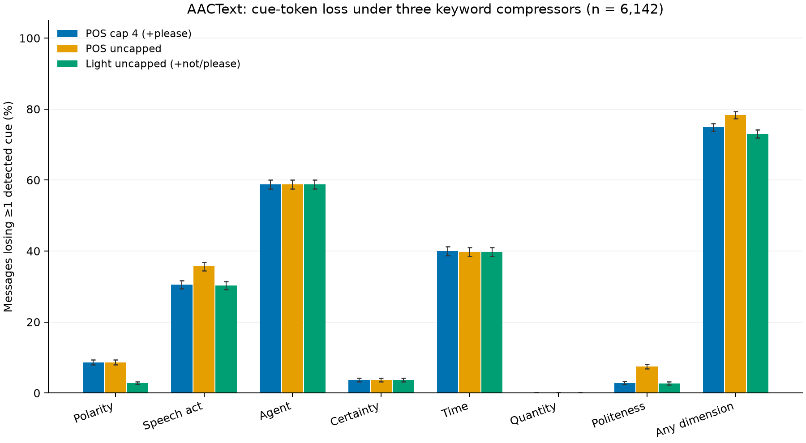

# S1: AACText cue loss and restoration cost

**H1 holds under this detector:** POS-cap4 loses ≥1 detected dimension in **4,602/6,142 (74.9%; 73.8–76.0)**; threshold ≥30%. These are cue-token retention estimates, not semantic judgments or AAC-user outcomes.

Uncapped POS: **4,812/6,142 (78.3%; 77.3–79.4)**. Light: **4,488/6,142 (73.1%; 71.9–74.2)**.

POS-cap4 observed collisions: **1,990/6,142 (32.4%; 31.2–33.6)**. At most two SPEC chip selections restore all detected category values in **4,961/6,142 (80.8%; 79.8–81.7)**; **176/6,142 (2.9%; 2.5–3.3)** have losses the current chip vocabulary cannot express.

## Data and reproducibility

AACText: Keith Vertanen and Per Ola Kristensson (2011), *The Imagination of Crowds: Conversational AAC Language Modeling using Crowdsourcing and Large Data Sources*, EMNLP, pp. 700–711. The [official corpus page](https://www.aactext.org/imagine/) was opened successfully during this analysis and verifies this citation, the fictional crowdsourcing protocol, and CC BY 4.0 for these resources (excluding lm_test_switch/lm_test_comm). A snapshot is saved as `corpus_source.html`. Only sent_{train,dev,test}_aac.txt were used. No exclusions for short/empty keyword outputs; nonempty source lines only. No participant or population-style claims.

Run: `. .venv/bin/activate && python -m src.s1_analyze`. Seed 20261031. `--initial` reproduces the frozen pre-fix validation predictions. Inputs and code hashes: `run_manifest.json`. All percentage intervals are Wilson 95% binomial intervals; these are descriptive sensitivity intervals, not worker-cluster sampling intervals. Workers are not identified in these text files.

| Split | Messages | Unique exact texts | Sample 400 n |
|---|---:|---:|---:|
| train | 5,019 | 4,662 | 319 |
| dev | 557 | 547 | 35 |
| test | 566 | 555 | 46 |
| all | 6,142 | 5,632 | 400 |

## Cue prevalence and loss

LOSS = count(source cue present AND at least one cue carrier absent)/all messages. A phrase requires all its carrying tokens. Token positions prevent repeated-word false survival. Unmarked defaults have no explicit cue. Time and quantity are separate dimensions. Multiple cues in a dimension use any-cue loss, even when another cue of the same value survives. Conditional loss divides by messages with that dimension present and is provided in `loss_rates.csv`.

Main subject is literal first-clause grammatical subject; imperatives remain unspecified. Request/refusal precedence beats question punctuation. `let's` is request/command to follow the requested S1 routing, despite the SPEC offer/suggestion option. Tense is main-predicate/auxiliary morphology plus explicit time words across the message. Full lexicon matches are retained as features; epistemic interpretation excludes obvious physical/ability/directional uses. Certainty is n/a for questions/requests. These heuristics do not resolve negation scope or coordinated-clause roles.

| Dimension | Cue present | POS-cap4 loss | Uncapped loss | Light loss |
|---|---:|---:|---:|---:|
| polarity | 531/6,142 (8.6%; 8.0–9.4) | 531/6,142 (8.6%; 8.0–9.4) | 531/6,142 (8.6%; 8.0–9.4) | 171/6,142 (2.8%; 2.4–3.2) |
| speech_act | 2,973/6,142 (48.4%; 47.2–49.7) | 1,877/6,142 (30.6%; 29.4–31.7) | 2,192/6,142 (35.7%; 34.5–36.9) | 1,860/6,142 (30.3%; 29.1–31.4) |
| agent | 4,296/6,142 (69.9%; 68.8–71.1) | 3,612/6,142 (58.8%; 57.6–60.0) | 3,612/6,142 (58.8%; 57.6–60.0) | 3,612/6,142 (58.8%; 57.6–60.0) |
| certainty | 273/6,142 (4.4%; 4.0–5.0) | 225/6,142 (3.7%; 3.2–4.2) | 225/6,142 (3.7%; 3.2–4.2) | 225/6,142 (3.7%; 3.2–4.2) |
| time | 3,713/6,142 (60.5%; 59.2–61.7) | 2,457/6,142 (40.0%; 38.8–41.2) | 2,442/6,142 (39.8%; 38.5–41.0) | 2,442/6,142 (39.8%; 38.5–41.0) |
| quantity | 68/6,142 (1.1%; 0.9–1.4) | 5/6,142 (0.08%; 0.03–0.19) | 2/6,142 (0.03%; 0.01–0.12) | 2/6,142 (0.03%; 0.01–0.12) |
| politeness | 691/6,142 (11.3%; 10.5–12.1) | 174/6,142 (2.8%; 2.4–3.3) | 457/6,142 (7.4%; 6.8–8.1) | 168/6,142 (2.7%; 2.4–3.2) |

Counts/n (percentage; Wilson 95% CI).

| Split | POS-cap4 any loss | Uncapped any loss | Light any loss |
|---|---:|---:|---:|
| train | 3,737/5,019 (74.5%; 73.2–75.6) | 3,906/5,019 (77.8%; 76.7–79.0) | 3,635/5,019 (72.4%; 71.2–73.6) |
| dev | 433/557 (77.7%; 74.1–81.0) | 458/557 (82.2%; 78.8–85.2) | 425/557 (76.3%; 72.6–79.6) |
| test | 432/566 (76.3%; 72.7–79.6) | 448/566 (79.2%; 75.6–82.3) | 428/566 (75.6%; 71.9–79.0) |

Compressors: (a) old NOUN/PROPN/VERB/ADJ/NUM excluding AUX and aux/auxpass, always keep please, first four tokens; (b) the same content POS filter without cap or please exception; (c) uncapped content POS plus not/n't (canonicalized to not) and please. No stopword filter or deduplication. The old minimum-two-keyword exclusion is deliberately not applied. Uncapped POS has more loss than cap4 here because it removes the old please exception: this comparison changes both the cap and the retention rule and is not a pure cap ablation.

## Collisions

A message counts when its exact ordered, space-joined keyword string is shared by a different source text with a differing detector label in any dimension (including time/quantity). Duplicate identical sources alone do not count. Pooled comparison allows cross-split collisions; split rows compare only within that split. This is a lower bound on possible ambiguity, constrained to attested texts and this codebook.

| Split | POS-cap4 | Uncapped | Light |
|---|---:|---:|---:|
| all | 1,990/6,142 (32.4%; 31.2–33.6) | 2,159/6,142 (35.2%; 34.0–36.4) | 1,895/6,142 (30.9%; 29.7–32.0) |
| train | 1,550/5,019 (30.9%; 29.6–32.2) | 1,675/5,019 (33.4%; 32.1–34.7) | 1,459/5,019 (29.1%; 27.8–30.3) |
| dev | 76/557 (13.6%; 11.0–16.7) | 86/557 (15.4%; 12.7–18.7) | 69/557 (12.4%; 9.9–15.4) |
| test | 95/566 (16.8%; 13.9–20.1) | 105/566 (18.6%; 15.6–22.0) | 89/566 (15.7%; 13.0–19.0) |

## Minimal chip cost and input actions

A chip restores its SPEC category value, not exact phrasing, temporal referent, subject identity, or negation scope. Repeated lost events with the same value need one chip; a retained event with that value already makes it available. A distinct lost value needs its matching chip. No default YES/TELL/PLAIN chip is charged because unmarked defaults are not explicit losses. The current SPEC cannot exactly encode lost quantities, thanks/apologies, softened-request forms, or unanchored time. Those cases have **no finite all-cue solution** in this vocabulary; their partial chip count is not presented as complete restoration.

| Minimum chips | POS-cap4 | Uncapped | Light |
|---|---:|---:|---:|
| 0 | 1,558/6,142 (25.4%; 24.3–26.5) | 1,348/6,142 (21.9%; 20.9–23.0) | 1,679/6,142 (27.3%; 26.2–28.5) |
| 1 | 1,584/6,142 (25.8%; 24.7–26.9) | 1,532/6,142 (24.9%; 23.9–26.0) | 1,562/6,142 (25.4%; 24.4–26.5) |
| 2 | 1,819/6,142 (29.6%; 28.5–30.8) | 2,016/6,142 (32.8%; 31.7–34.0) | 1,873/6,142 (30.5%; 29.4–31.7) |
| 3 | 953/6,142 (15.5%; 14.6–16.4) | 1,010/6,142 (16.4%; 15.5–17.4) | 849/6,142 (13.8%; 13.0–14.7) |
| 4 | 49/6,142 (0.80%; 0.60–1.05) | 63/6,142 (1.0%; 0.8–1.3) | 9/6,142 (0.15%; 0.08–0.28) |
| 5 | 3/6,142 (0.05%; 0.02–0.14) | 3/6,142 (0.05%; 0.02–0.14) | 0/6,142 (0.00%; 0.00–0.06) |
| unrestorable | 176/6,142 (2.9%; 2.5–3.3) | 170/6,142 (2.8%; 2.4–3.2) | 170/6,142 (2.8%; 2.4–3.2) |

Costs below are means; no Wilson intervals apply to means. Character counts include original punctuation/spaces or single keyword separators. One chip selection costs one action. Predicted keywords each cost one selection; typed keywords cost their joined character count. Full-text character cost is a typing reference, not a measured motor/access-time cost. Literal bracketed-chip typing is also available in CSV, distinct from one-selection chips.

| Compressor | All n | Full chars, all | Keyword chars, all | Keyword selections, all | Fully restorable n | Chips, feasible | Typed keywords + chip selections, feasible | Predicted words + chips, feasible | Full chars, feasible |
|---|---:|---:|---:|---:|---:|---:|---:|---:|---:|
| pos_cap4 | 6142 | 23.46 | 11.02 | 2.06 | 5966 | 1.39 | 12.32 | 3.43 | 23.12 |
| pos_uncapped | 6142 | 23.46 | 10.96 | 2.05 | 5972 | 1.48 | 12.37 | 3.52 | 23.16 |
| light | 6142 | 23.46 | 11.58 | 2.17 | 5972 | 1.32 | 12.81 | 3.47 | 23.16 |

## Detector validation: 150 source-only LLM labels, one revision

A uniform random sample without replacement was drawn before inspecting predictions. The executing LLM read and independently labeled every sampled source in `manual_labels_compact.txt`, then inspected the initial predictions, fixed obvious bugs once, and reran. `detector_check.csv` contains source, initial/final predictions, LLM labels, and agreement flags. This is an unblinded development check by the same LLM that wrote the code, **not independent human validation or a held-out accuracy estimate**. Gold was frozen before prediction inspection and was not edited to improve agreement.

| Dimension | Initial agreement | After one revision |
|---|---:|---:|
| polarity | 150/150 (100.0%; 97.5–100.0) | 150/150 (100.0%; 97.5–100.0) |
| speech_act | 136/150 (90.7%; 84.9–94.4) | 150/150 (100.0%; 97.5–100.0) |
| agent | 141/150 (94.0%; 89.0–96.8) | 150/150 (100.0%; 97.5–100.0) |
| certainty | 142/150 (94.7%; 89.8–97.3) | 150/150 (100.0%; 97.5–100.0) |
| time | 129/150 (86.0%; 79.5–90.7) | 146/150 (97.3%; 93.3–99.0) |
| quantity | 150/150 (100.0%; 97.5–100.0) | 150/150 (100.0%; 97.5–100.0) |
| politeness | 149/150 (99.3%; 96.3–99.9) | 150/150 (100.0%; 97.5–100.0) |

Quantity has **zero positive cases** in the 150-message uniform sample: its agreement only checks absence, not number recall. Separate executable diagnostics cover numeric examples, contraction normalization, hedge overlap, old-compressor parity, and chip infeasibility. Remaining disagreements are retained in `detector_disagreements.csv`; see `validation_notes.md` for fixes and ambiguous readings. No tuning was done after the single revision.

## Stratified sample for later expansion

`data/specs/aactext_sample400.jsonl` contains 400 unique source IDs, original splits/text, detector labels, and all three keyword lists. Sequential disjoint quotas draw 55 messages each for negation, modal/hedge match, question, second-person main subject, and please, then a uniform random fill of 125 from remaining messages. Overlapping features can exceed their quotas; exact draw strata are saved. Sampling is without replacement by message ID; duplicate source texts may remain. This challenge sample is not prevalence representative and has no simple inverse-probability weights.

| Feature | Corpus | Sample 400 |
|---|---:|---:|
| negation | 531/6,142 (8.6%; 8.0–9.4) | 69/400 (17.2%; 13.9–21.3) |
| modal_or_hedge | 1,118/6,142 (18.2%; 17.3–19.2) | 130/400 (32.5%; 28.1–37.2) |
| question | 1,439/6,142 (23.4%; 22.4–24.5) | 133/400 (33.2%; 28.8–38.0) |
| second_person | 1,059/6,142 (17.2%; 16.3–18.2) | 126/400 (31.5%; 27.1–36.2) |
| please | 350/6,142 (5.7%; 5.1–6.3) | 70/400 (17.5%; 14.1–21.5) |

## Files and practical limits

`message_metrics.csv` has one row per source × compressor and source-indexed cue evidence; `message_cues.jsonl` is the nested reusable form. Aggregate CSVs include all splits and Wilson intervals. `cost_summary.csv` separates feasibility and all-message costs; `collisions.csv` lists every observed collision. `sample_strata.csv` includes split-specific sample counts. `run_manifest.json` records versions and hashes.

H1 is supported for this pilot cue detector. The high rate partly reflects omitted grammatical subjects, auxiliary tense, and question forms; retained inflections and imperative roots can count as surviving cues even though word order/scope is gone. Errors in deterministic detection propagate to every endpoint. A source-only human review, worker-aware uncertainty if metadata become available, and scope-aware semantic annotation are needed before stronger claims. The SPEC chip vocabulary needs explicit decisions about exact quantities and mitigation forms before an all-cue Pareto analysis.
